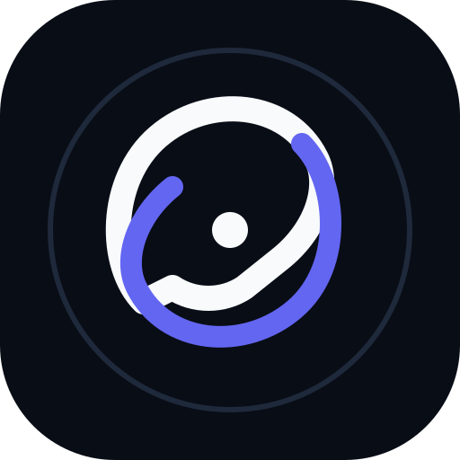
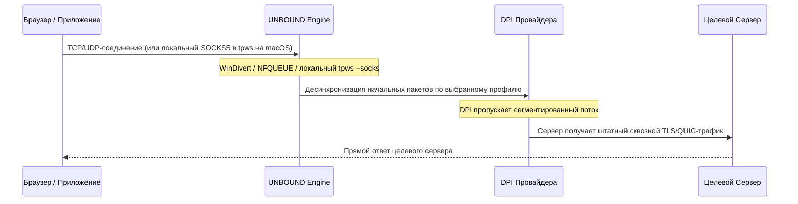

<div align="center">



# UNBOUND `v0.8.0`
**Локальный десктопный и консольный клиент десинхронизации DPI на уровне L3/L4 на базе Zapret 2 (`winws2` / `nfqws2`) и `tpws`.**

[](#)
[](#)
[](SECURITY.md)
[](LICENSE)

[**🔒 Безопасность**](#-безопасность-и-гарантии-доверия) &nbsp; | &nbsp; [**🖥️ Интерфейс**](#-интерфейс-и-дизайн-система-precision-monochrome) &nbsp; | &nbsp; [**⚡ Архитектура**](#-как-работает-движок) &nbsp; | &nbsp; [**📦 Сборка**](#-сборка-из-исходников)

</div>

---

## 🎨 Интерфейс и Дизайн-Система (Precision Monochrome)

Фронтенд приложения построен в рамках концепции **Precision Monochrome** — строгого и функционального десктопного минимализма без внешних сетевых зависимостей:

- **0% лишнего неона и декоративных градиентов**: Выдержанная индустриальная палитра на основе глубокого обсидиана, графита и тёплой бумаги с полностью локальными шрифтами `Inter`.
- **Точечное использование цвета**: Семантические статус-диоды (зелёный — активен, жёлтый — подключение/перепроверка, красный — ошибка, серый — остановлен).
- **Платформ-ориентированная шапка**: macOS светофоры слева, Windows 11 Fluent контролы справа, корректное завершение окна на Linux без зависших фоновых процессов.
- **Интегрированные темы** (`Monolith`, `Paper`, `Graphite` и автоматический режим `System`).

---

## ⚙️ Ключевые возможности

- **Актуальный движок**: встроенный **Zapret 2 v1.0.5.1** (`winws2.exe` + WinDivert на Windows; `nfqws2` + NFQUEUE/`nftables` на Linux) с Lua-стратегиями; на macOS — universal **Zapret `tpws --socks`** через системный SOCKS5 активного маршрута.
- **AutoTune vNext (Single-Host & Bounded ServiceGraph)**: доказательный замкнутый цикл (`OBSERVE → DIAGNOSE → PLAN → ORDER → ACT → VALIDATE → REMEMBER → REVALIDATE`) как для отдельного hostname (до 8 точных A/AAAA endpoint), так и для встроенных мультихостовых пресетов **ServiceGraph** (`YouTube`, `Discord`, до 4 точных узлов-хостов в едином union-захвате `winws2` / `nfqws2`). Включает потоковый прогресс по стадиям, мгновенную отмену, контролируемую проверку окна передачи байт (`TransferContract` для выявления `PARTIAL_TRANSFER_ANOMALY`), транзакционные Apply/Suspend/Revert и анонимизированный журнал истории результатов (`Outcome Ledger` с HMAC-SHA256 `ContextKey`).
- **Strategy Lab (Лаборатория поиска)**: изолированный поиск работающих стратегий на базе алгоритмов BlockCheck2 со строгим фильтром `--wf-raw-filter` только по IP тестируемой цели, проверкой возможностей стека и гарантированным возвратом исходного профиля после теста.
- **Адаптивный профиль (Adaptive Experimental)**: динамическая оркестрация на базе `zapret-auto.lua` (`circular`), переключающая стратегии для конкретных доменов по подтверждённым сбоям.
- **AutoHostlist**: автоматическое пополнение списка блокируемых доменов (`autodetect.txt`) с управлением, очисткой и переносом в постоянные списки из UI.
- **Central Operation Coordinator**: координатор исключительных операций с безопасным ожиданием завершения отменённой задачи, исключающий конкурентный доступ двух движков к WinDivert/NFQUEUE.
- **UNBOUND Doctor**: двухуровневая асинхронная диагностика (быстрая и расширенная) привилегий, сетевого стека, конфликтующих процессов/VPN и доступности YouTube, Discord (включая RFC 6455 WebSocket Gateway Opcode 10) и Steam.
- **Сравнение A/B (Bypass Comparison)**: транзакционный замер эффективности профиля относительно прямого соединения с автоматическим восстановлением активного профиля.
- **Самовосстановление автозапуска и тихий старт**: автоматическое обновление пути в Планировщике задач Windows, запуск в трей без мигания консольных окон (`StartHidden` + `CREATE_NO_WINDOW`) и синхронизация статуса трея с AutoTune vNext.

---

## 🔒 Безопасность и Гарантии Доверия

В отличие от сервисов, внедряющих собственные корневые сертификаты (Root CA) или перенаправляющих трафик через сторонние серверы:

- 🛡️ **Без телеметрии и аналитики**: приложение не отправляет метрики, идентификаторы или историю соединений.
- 🔑 **Без MITM и подмены Root CA**: TLS-соединение устанавливается напрямую между клиентом и целевым сервером.
- 🧱 **Без беспарольных `sudoers`-бекдоров**: установщики и провайдеры не создают правил `NOPASSWD` в `/etc/sudoers.d/`, а обновление `.pkg` на macOS автоматически удаляет устаревшие записи.
- 📜 **Контроль целостности бинарников (SHA256)**: все встроенные активы проверяются по `engine/ENGINE_ASSETS.sha256` до привилегированного запуска и защищены правами доступа уровня администратора/владельца.
- 📋 Подробная документация: [**`SECURITY.md`**](SECURITY.md) и [**`docs/SECURITY_AUDIT.md`**](docs/SECURITY_AUDIT.md).

---

## 🛠️ О проекте

**UNBOUND** — локальный инструмент десинхронизации сетевых пакетов на уровне L3/L4. Он **не является VPN** или внешним прокси-сервисом.

На Windows и Linux приложение перехватывает начальные пакеты рукопожатий и применяет стратегии Zapret 2 (`winws2` / `nfqws2`). На macOS используется локальный SOCKS5-прокси `tpws --socks` (`127.0.0.1:9888`) на активном сетевом интерфейсе с полным восстановлением системных настроек при остановке.

---

## 🖥️ Поддерживаемые платформы

| Платформа | Драйвер / Механизм | Статус проверки |
| :--- | :--- | :---: |
| **Windows 10/11 x64 (`windows/amd64`)** | `WinDivert` + Zapret 2 `winws2.exe` | ✅ Проверены runtime и сеть |
| **macOS Apple Silicon (`darwin/arm64`)** | Universal Zapret `tpws --socks` + system SOCKS5 | ✅ Проверен runtime |
| **macOS Intel (`darwin/amd64`)** | Universal Zapret `tpws --socks` + system SOCKS5 | ⚠️ Проверена сборка universal-бинарника |
| **Linux amd64 (`linux/amd64`)** | `NFQUEUE` + `nftables` / `iptables` + `nfqws2` | 🟡 Экспериментальный (`unbound-v0.8.0-linux-amd64.tar.gz`, `.deb`/`.rpm`/Arch `packaging/`) |
| **Linux arm64 (`linux/arm64`)** | `NFQUEUE` + `nftables` / `iptables` + `nfqws2` | 🟡 Экспериментальный (сборка из исходников) |

Подробная матрица приёмки и ограничений платформ: [**`docs/PLATFORMS.md`**](docs/PLATFORMS.md) и [**`docs/MACOS.md`**](docs/MACOS.md).

## ⚡ Как работает движок



---

## 💻 Использование CLI и Запускные Скрипты

Помимо десктопного GUI, UNBOUND поддерживает полноценный консольный режим и скрипты быстрого запуска (`scripts/control_windows/`, `scripts/control_linux/`, `scripts/control_macOS/`).

### Интерактивный центр управления (`--control`)
```bash
sudo ./unbound --control
```

### Запуск профиля и AutoTune vNext из CLI
```bash
sudo ./unbound --cli --profile ultimate                            # Linux / macOS
./Unbound.exe --cli --profile rec                                  # Windows (в терминале Администратора)
sudo ./unbound --autotune-vnext --autotune-vnext-target https://www.youtube.com
sudo ./unbound --autotune-vnext --service-preset youtube           # Мультихостовый ServiceGraph пресет
```

### Экспериментальная поддержка Linux (`amd64` CLI и пакеты)

Релизный таргет `unbound-v0.8.0-linux-amd64.tar.gz` поставляет самодостаточный CLI-архив с проверкой `BUNDLE_SHA256SUMS.txt`; также в каталоге `packaging/` доступны актуальные сценарии сборки `.deb`, `.rpm`, `PKGBUILD` и unit-файл `unbound.service` (`systemd`). Для перехвата трафика требуются права `root`, ядро Linux с `NFQUEUE` и `nftables` (`iptables` поддерживается как fallback). Linux-таргет остаётся **EXPERIMENTAL**.

---

## 📦 Сборка из исходников

### Требования:
- **Go** 1.26+
- **Node.js** 22+
- **Wails v2.13+**: `go install github.com/wailsapp/wails/v2/cmd/wails@v2.13.0`

### Команды сборки:

```bash
# 1. Клонирование репозитория
git clone https://github.com/bobberdolle1/unbound.git
cd unbound

# 2. Полная локальная проверка (frontend + gofmt + go vet + тесты + проверка SHA256 ассетов)
make check

# 3. Сборка фронтенда и CLI/GUI бинарника
cd frontend && npm ci && npm run build && cd ..
VERSION="$(node -p "require('./wails.json').info.productVersion")"
go build -trimpath -ldflags="-s -w -X unbound/engine.Version=$VERSION" -o build/bin/unbound .

# 4. Сборка нативного десктопного пакета через Wails
wails build -clean -ldflags "-X unbound/engine.Version=$VERSION"
```

---

## ⚖️ Лицензия & Отказы

Распространяется на условиях лицензии **GPL-3.0**. Все права на сторонние компоненты (`zapret2`, `zapret`/`tpws`, `WinDivert`) принадлежат их авторам и лицензированы отдельно (`LICENSE`, `engine/third_party/ZAPRET2_LICENSE.txt`, `engine/third_party/ZAPRET_LICENSE.txt`, `engine/ENGINE_PROVENANCE.json`).
